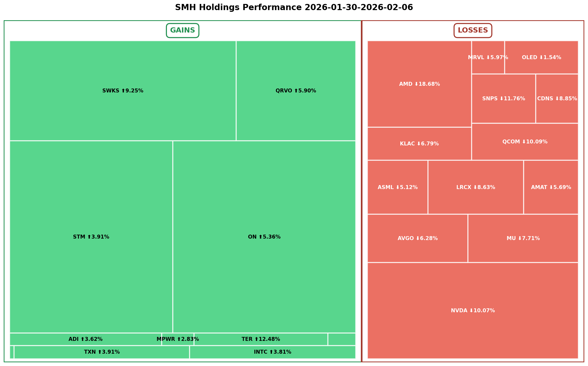
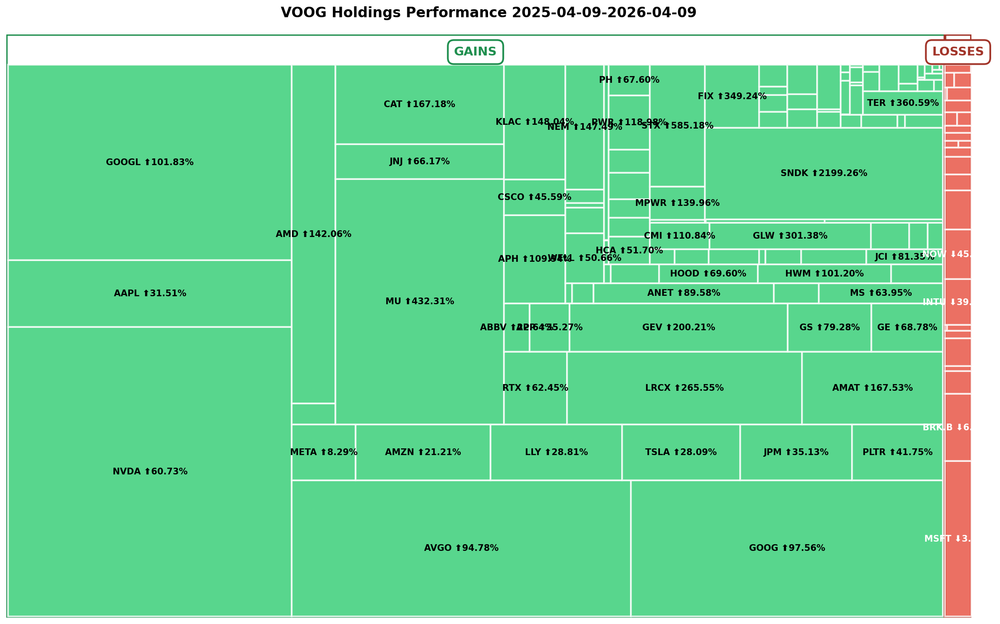
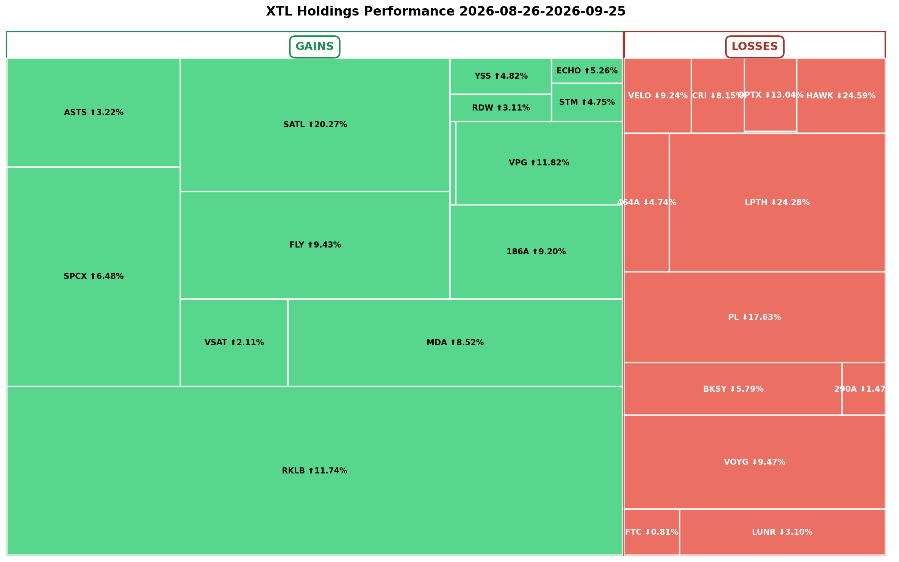

# ETF Holdings Performance Treemap

A command-line tool that shows which holdings are driving an ETF's performance. **Bring your own holdings file:** you download the ETF's holdings CSV from the issuer's website and give its path to the tool. The tool does not fetch holdings from the web. It looks up price changes with Yahoo Finance (via `yfinance`) and renders a treemap PNG. Block size is each holding's contribution (portfolio weight x price change). Gains and losses are split into two proportionally sized sections.

## Features

- Gains (green) and losses (red) in separate sections, sized by total contribution
- Flat holdings (grey) are folded into the smaller section
- Lookback periods in days, weeks, months or years (`1d`, `2w`, `3m`, `1y`)
- Holdings from a CSV file you provide, in one of several supported formats
- Symbol normalization for international listings (for example `MDA CN` becomes `MDA.TO`)
- PNG output with high resolution

## Requirements

- Python 3.12 or newer
- [`uv`](https://docs.astral.sh/uv/) for environment and dependency management

## Installation

```bash
git clone https://github.com/prb/etf-performance-treemap.git
cd etf-performance-treemap
uv sync   # installs runtime and dev tools (pytest, hypothesis, pytest-cov)
# uv sync --no-dev   # runtime dependencies only
```

`uv sync` creates a project-local `.venv` and installs the locked dependencies from `uv.lock`.

## Usage

```bash
uv run etf-treemap <ETF_SYMBOL> <LOOKBACK_PERIOD> --csv HOLDINGS_FILE
# equivalent:
uv run python -m etf_treemap.main <ETF_SYMBOL> <LOOKBACK_PERIOD> --csv HOLDINGS_FILE
```

Arguments:

- `ETF_SYMBOL`: the ETF ticker (for example `UFO`, `QQQM`). Letters, digits, `.` and `-` only, up to 15 characters.
- `LOOKBACK_PERIOD`: a positive integer followed by `d`, `w`, `m` or `y`. Months are treated as 30 days and years as 365 days.
- `--csv HOLDINGS_FILE` (alias `--holdings`): path to the holdings file you downloaded. **Required.** The flag keeps its original name so existing command lines keep working.

The output is written to the current directory as `{ETF_SYMBOL}-{LOOKBACK_PERIOD}-treemap.png`. An existing file with that name is overwritten.

### Examples

```bash
# Use a holdings file from this repository
uv run etf-treemap QQQM 1w --csv example-holdings/QQQM-holdings.csv

# Use a file you downloaded yourself
uv run etf-treemap UFO 1d --csv ~/Downloads/UFO-holdings.csv

# Longer lookbacks
uv run etf-treemap VOOG 1y --csv example-holdings/VOOG-holdings.csv
```

### Getting a holdings file

Download the full holdings list from the ETF issuer's own fund page (usually a "Holdings" tab with a download or export button), or from a data provider that offers CSV export. Issuers change their pages and file layouts, so this project does not link to specific file URLs. Sources that produce files this tool reads:

- ETF Database (etfdb.com) holdings export, as in most files in `example-holdings/`
- Invesco: the monthly holdings file on the fund's page
- Fund administrators and issuers that publish a daily holdings file (for example the Spear Advisors file in `example-holdings/`)
- Any other CSV that meets the generic rule below

### Supported file formats

The parser skips any metadata lines at the top, finds the header row, and reads the symbol, name and weight columns. All files must be UTF-8 CSV.

| Format | Header row | Example in `example-holdings/` |
| --- | --- | --- |
| ETF Database export | `Holding,Symbol,Weighting` (metadata lines first) | `QQQM-holdings.csv` |
| Invesco monthly holdings | `Ticker,Company,Share/ Par,% TNA,...` | `invesco_nasdaq_100_etf-monthly_holdings.csv` |
| Fund-administrator export | `Date,Account,StockTicker,CUSIP,SecurityName,...,Weightings,...` | `SpearAdv.40FU.FU_Holdings.csv` |
| Generic | a symbol column (`Symbol`, `Ticker`, `StockTicker`) and a weight column (`Weighting`, `Weightings`, `Weight`, `% of Net Assets`, `% TNA`); the name column is optional | |

Weights may be written as `6.15%` (read as 0.0615) or as a bare number. If the file is missing, unreadable, empty or in none of these layouts, the tool prints an error that lists the supported formats and exits with status 1.

## Configuration

No API key or account is required. The tool reads no environment variables.

`FMP_API_KEY.secret` is a local, git-ignored file name reserved for a possible future Financial Modeling Prep integration. Nothing in the current code reads it. The `.gitignore` excludes every `*.secret` file, so a key stored that way will not be committed. Never put a real key in the README, in code or in a committed file.

## Sample output

Example treemaps are kept in [`sample-treemaps/`](sample-treemaps/). Generated PNGs in the project root are git-ignored; copy any you want to keep into that folder.





## Reading the treemap

- Left section (green): holdings that rose. Right section (red): holdings that fell.
- Section width is proportional to the total contribution inside it, so you can see at a glance whether gains or losses dominate.
- Block area is proportional to `abs(weight x price change)`.
- Labels show the symbol, an arrow and the percentage change, for example `PL ⬆3.45%`. Very small blocks are left unlabeled.
- The title shows the ETF and the date range.

## Troubleshooting

| Message | What to do |
| --- | --- |
| `the following arguments are required: --csv` | Pass the path of the holdings file you downloaded. |
| `Holdings file not found` | Check the path given to `--csv`. |
| `Unsupported or empty holdings file` | The file is not in a supported format; see the list above. |
| `Invalid ETF symbol` | Use letters, digits, `.` and `-` only. |
| `No valid price data available` | Symbols may not exist on Yahoo Finance; try another lookback. |
| `Could not retrieve price data for X` (warning) | The holding (cash, money market funds, some international listings) is skipped. |
| `Could not save file` | Check write permission in the current directory. |

## Limitations

- You must supply the holdings file; the tool does not download or refresh it.
- Price data comes from Yahoo Finance and may be delayed or missing for some securities.
- `1d` measures the change from the previous session's close to the latest price. Market hours are evaluated in US/Eastern time (09:30 to 16:00, Monday to Friday). Holidays are not hard-coded: if no bars dated today come back during market hours, the tool uses the last two daily closes instead. If the previous close is unavailable while the market is open, it falls back to the first bar of the day.
- Titles and price fetches share one date range, computed when the run starts.
- Large ETFs take longer because prices are fetched one symbol at a time.

## Development

```bash
uv run pytest                      # full suite with terminal coverage summary
uv run pytest --cov-report=html    # also write the HTML report to htmlcov/ (git-ignored)
uv run pytest tests/unit           # unit tests only
uv run pytest tests/property       # property-based tests (Hypothesis)
```

Project layout:

```
etf_treemap/
├── cli.py              # argument parsing and lookback validation
├── holdings.py         # holdings file format detection and parsing
├── symbol_mapper.py    # issuer symbol -> Yahoo Finance symbol
├── prices.py           # price changes via yfinance
├── calculator.py       # contribution and direction calculation
├── visualizer.py       # treemap rendering with matplotlib and squarify
└── main.py             # orchestration and exit codes
tests/                  # unit, property and integration tests
example-holdings/       # sample holdings CSV files
sample-treemaps/        # sample output PNGs
```

Dependencies are managed with `uv` and pinned in `uv.lock`. The project sets `exclude-newer = "P3D"` under `[tool.uv]`, so new releases are only picked up after a three day cooldown. Update with `uv lock --upgrade && uv sync`.

## Contributing

Issues and pull requests are welcome. Please run `uv run pytest` before submitting.

## License

Released under the [MIT License](LICENSE). Copyright (c) 2026 Multifarious, LLC.

## Acknowledgments

- [yfinance](https://github.com/ranaroussi/yfinance) for price data
- [squarify](https://github.com/laserson/squarify) for the treemap layout algorithm
- [matplotlib](https://matplotlib.org/) for rendering
